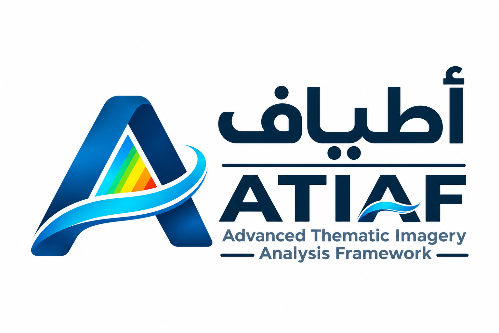
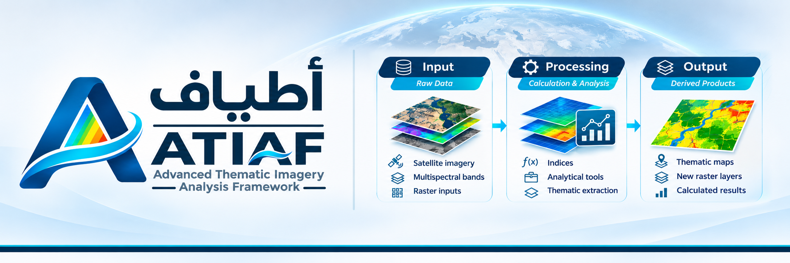

<p align="center"></p>
<p align="center"></p>

# أطياف — ATIAF

[](LICENSE)
[](CHANGELOG.md)
[](https://github.com/ahmadibrahim4geo/ATIAF/actions/workflows/structure-check.yml)

إطار مفتوح المصدر للتحليل الموضوعي للمرئيات الفضائية · ترخيص MIT · معالجة محلية.

[English](README.md) · [بوابة التوثيق](documentation/index.html) · [ابدأ الاستخدام](documentation/ar/QUICK_START.md) · [أدلة التحقق](Reports/INDEX.md)

**محرك واحد اسمه `atiaf_core` بحرف I** تستخدمه واجهتا ArcGIS Pro وQGIS. ليست هناك نواتان مختلفتان للمضيفين. تعمل الحسابات على مرئياتك المحملة والمفكوكة محليًا، دون حساب مزود أو مفتاح API أو تنزيل مرئيات تلقائي.

**الإصدار 1.0.4.dev0 نسخة تطوير وإصلاح.** تُصحح ادعاءات جاهزية v1.0.0 في [التقرير 0015](Reports/0015_recovery_audit.md). اختبار البيانات الصناعية مختلف عن تشغيل المضيف الأصلي، وعن مرئية حقيقية، وعن تثبيت نظيف. راجع [حالة المشروع](PROJECT_STATE.md).

## المشروع في نظرة

| المنصة | نقطة البداية | النطاق |
|---|---|---|
| ArcGIS Pro | صندوق أدوات أصلي بالعربية وآخر بالإنجليزية | يحتاج تثبيت Pro وترخيصه المستقلين |
| QGIS | إضافة Processing داخل حزمة ZIP | يستخدم QGIS المثبت واعتمادياته العلمية المستقلة |
| محرك Python المشترك | `atiaf_core/` | مصدر واحد للكشف والتحقق العلمي والمعالجة والتوثيق |
| التوثيق | [Index المحلي](index.html) · [العربية](documentation/ar/QUICK_START.md) · [English](documentation/en/QUICK_START.md) | الاستخدام والمعادلات وتفسير النتائج وأدلة التحقق |

**المعالجة محلية:** اختر المستشعر والمنتج، ثم المرئيات أو الباندات اليدوية، وحدد الحسابات. الدمج والقص اختياريان، والمسقط من منتقي البرنامج الأصلي بالمتر. النتائج تتراكم في Work وResults دون استبدال القديم، والإضافة للخريطة اختيارية ومتتابعة.

## أول تشغيل

1. احتفظ بالمستودع كاملًا. في Pro افتح [ATIAF_AR.pyt](ArcGIS%20Pro%20Tools/ATIAF_AR.pyt) للعربية، أو [ATIAF.pyt](ArcGIS%20Pro%20Tools/ATIAF.pyt) للإنجليزية. ابدأ بدليل [التثبيت](documentation/ar/INSTALLATION.md).
2. في QGIS أنشئ الحزمة بالأمر `python tools/build_qgis_plugin.py` وثبّت ZIP من مدير الإضافات ثم فعّل ATIAF. لغة الأدوات تتبع لغة البرنامج.
3. الترتيب: **المستشعر والمنتج ← الإدخال ← الجودة ← الدمج الاختياري ← الحسابات ← مضلع الدراسة ← المسقط الأصلي بالمتر ← الإضافة الاختيارية للخريطة ← مجلد الحفظ أخيرًا**. جميع الحسابات غير محددة افتراضيًا.
4. لتجربة NDVI اختر Landsat C2 L2 SR ومعه الأحمر وتحت الحمراء القريبة وأقنعة الجودة. حدّد NDVI، واترك الدمج مغلقًا والقص فارغًا. أعد استخدام مسقط المصدر المعروف إن كان ملائمًا بالمتر، ثم افحص الراستر وتقريره في `Results/Reports/index.html`.

### الحصول على حزمة QGIS

بعد نجاح [مسار فحص وبناء الحزم](https://github.com/ahmadibrahim4geo/ATIAF/actions/workflows/structure-check.yml)، نزّل مخرج **ATIAF-QGIS-development**، وفك غلاف الأرشيف الذي يقدمه Actions للوصول إلى ZIP الإضافة القابل للتثبيت. تنزيل المخرجات يحتاج تسجيل الدخول إلى GitHub. هذه نسخ تطوير وليست إصدارات مستقرة.

للبناء محليًا من جذر المستودع:

```bash
git clone https://github.com/ahmadibrahim4geo/ATIAF.git
cd ATIAF
python tools/build_qgis_plugin.py
```

البناء يحفظ الحزم السابقة؛ استخدم `--output` باسم جديد عند إعادة البناء. ثبّت الناتج من QGIS ← الإضافات ← إدارة وتثبيت الإضافات ← التثبيت من ZIP. حافظ على فصل بيئتي Python الخاصتين بالمضيفين، وراجع [شروط التثبيت](documentation/ar/INSTALLATION.md).

## الأدوات المستقلة السبعة

| الأداة | الخيارات والقدرات | أبرز المزايا والتحديثات الأخيرة |
|---|---|---|
| المؤشرات الطيفية | 30 مؤشراً بصرياً مستقلاً (تشمل NDVI وSAVI وEVI وMNDWI وNDMI وNDBI وNBR، بالإضافة لـ 6 مؤشرات متقدمة جديدة من ENVI 6.3: `MTVI2` و`MCARI2` و`NDRE2` و`CIGREEN` و`CIREDEDGE` و`NDSI_SALINITY`) | معايرة إشعاعية وأقنعة جودة؛ معالجة وقص الانعكاس السالب لمنع أخطاء القسمة فوق المياه الداكنة والظلال |
| حرارة السطح | اشتقاق مبسط لدرجة حرارة السطح (LST) بنقرة واحدة بالدرجة المئوية أو الكلفن، مع حساب وحفظ مؤشر NDVI الوسيط تلقائياً | معاملات RTE و Planck افتراضية دقيقة؛ حفظ تلقائي لمؤشر NDVI في `Results/Vegetation/NDVI/` |
| التحليل الحراري والعمراني | مؤشر التفاوت الحراري العمراني (UTFVI) وتصنيفه، ورصد البؤر الحرارية السطحية | حرارة سطح رسمية وتشخيص الجزر الحرارية الحضرية |
| البيئة والجفاف | بياض السطح الكلي لمستشعرات TM/ETM+، ومؤشرات الجفاف النباتي | معايرة متعددة الأجيال لمنتجات لاندسات |
| الجيولوجيا والمعادن | 10 نسب ومؤشرات لتحولات المعادن ونطاقات التحول الحرمائي (تشمل الحديد الحديديك وتحول الصلصال، و4 مؤشرات جديدة من ENVI: `FEAI`, `FEI`, `FESI`, `LATI`) | حساسية عالية لنطاقات التحول المعدني وتمييز الصخور الحاملة للخامات |
| الزمن والتغير | فروق NDVI أو NBR أو LST متعددة التواريخ | طرح زمني مرتب (T2 ناقص T1) مع تطابق المستشعر ومستوى المعالجة |
| [التراكيب اللونية الجيولوجية](documentation/ar/GEOLOGICAL_COLOR_COMPOSITES.md) | تراكيب RGB المباشرة (`7-5-3`, `7-6-2`, `3-2-1`) وتراكيب نسب الباندات (`CRC1`, `CRC2`) | ناتجان متزامنان: راستر تحليلي خام عالي الدقة (Float32) وراستر ملون للعرض المباشر (8-بت بتمديد 2%) |

### محرك أقنعة الجودة الذكي والقضاء على "الثقوب البيضاء"
تم تزويد منظومة أطياف بمحرك جودة ذكي متعدد الأنماط (`Cloud_Only_Arid`، `Full_Strict`، `Water_Protected`، `None`):
- **`Cloud_Only_Arid` (النمط الافتراضي لجميع الأدوات):** مصمم خصيصاً للبيئات الجافة والصخرية والصحراوية (مصر، الشرق الأوسط، وشمال إفريقيا). يحجب بصرامة السحب الركامية الحقيقية (البت 3) والثلوج (البت 5)، مع **إلغاء الإنذارات الكاذبة** لخوارزميات الفضاء التي كانت تعتبر قمم الجبال الصحراوية وظلال التضاريس سحباً رقيقة. هذا التحديث **قضى تماماً على مشكلة الخلايا المفقودة والثقوب البيضاء** (استعادة 23,676 بكسل صخري في الاختبارات الواقعية وانعدام الفجوات فوق مياه النيل).
- **`Full_Strict`:** قناع صارم للمناطق الرطبة والمحيطية.
- **`Water_Protected`:** حماية مخصصة للمسطحات المائية والجزر من تمدد أقنعة السحب.

### دعم متعدد الأجيال لمرئيات الأقمار الصناعية
- دعم تلقائي كامل لمرئيات **Landsat 9 و Landsat 8 Collection 2 Level-2** (انعكاسية وحرارة السطح).
- توافق تام مع المرئيات القديمة **Landsat 4/5/7/8 Level-1 (Pre-Collection و Collection 1)** بحساب انعكاسية TOA المعايرة (`allow_toa=True`) واشتقاق الإشعاع الحراري.
- كشف وتعيين فيزيائي لباندات **Sentinel-2 L2A & L1C** و **ASTER**.

## شجرة ملفات ومجلدات المخرجات

تُنظم النواتج بنظافة واحترافية وبأسماء موجزة معبّرة:
- **`[StudyArea_]Method_Date.tif`:** راستر تحليلي خام (Float32) يحفظ القيم الحقيقية للتحليل الإحصائي والنمذجة المكانية.
- **`[StudyArea_]Method_Date_DISPLAY.tif`:** راستر ملون (Byte RGB) ممتد بنسبة 2% للإسقاط والعرض الفوري على الخريطة.
- **`[StudyArea_]Method_Date.preview.png / .html`:** صورة استعراض ومعاينة تفاعلية بالمتصفح دون الحاجة لبرامج GIS.
- **`report.ar.html` و `report.en.html`:** تقارير علمية ورسمية ثنائية اللغة توثق المعادلات، والمصادر الأكاديمية، والبيانات الوصفية والإحصائية.
- **`Processing_Manifest.json` و `Quality_Assessment.csv`:** بيان تقني للتشغيل وتوزيع البكسلات الصالحة والسحب.

## التحقق والأدلة الواقعية

- **192 اختباراً برمجياً مؤتمتاً بنجاح 100%** في 8.3 ثانية.
- **تحقق واقعي مزدوج على مرئيات حقيقية:** اختبار كامل على مرئية حديثة (Landsat 9 C2 L2 - أسوان والنيل) ومرئية قديمة (Landsat 8 L1T - سيناء)، مع اختفاء كامل للثقوب البيضاء وخلو النواتج من أي قيم مشوهة (NaN).
- راجع تقرير التسليم الشامل: **[Report 0032](Reports/0032_advanced_envi_indices_and_qa_mask_engine.md)** و **[Report 0031](Reports/0031_comprehensive_usability_geological_and_envi_integration.md)**.

## التطوير والمساهمة

في بيئة تطوير مستقلة ومتوافقة:

```bash
python -m pip install .
python tools/build_documentation.py
python tools/validate_package.py
python -m unittest discover tests
```

اختبارات GIS الأصلية تُنفذ منفصلة داخل بيئات البرامج. لا تخلط الحزم الثنائية عشوائيًا في Pro أو QGIS. راجع [المساهمة](.github/CONTRIBUTING.md) و[الأمان والبيانات الخاصة](.github/SECURITY.md) و[بيانات الاستشهاد](CITATION.cff)، واستشهد بالبحوث الأصلية لكل طريقة بجانب البرنامج.

## تنظيم المشروع

| المجلد | وظيفته |
|---|---|
| `atiaf_core/` | المحرك المشترك الوحيد؛ لا يوجد محرك آخر بحرف Y |
| `ArcGIS Pro Tools/` و`QGIS Tools/` | واجهتان أصليتان منفصلتان للمضيفين |
| `documentation/` | شرح عربي وإنجليزي وبوابة وصور؛ المواصفات والقرارات والخارطة داخل `project/` |
| `scientific_library/` | مرشحات ومستشعرات ومصادر علمية، تختلف عن دعم التنفيذ |
| `tools/` | صيانة وفحص البيئة والتحقق وبناء الحزم؛ ليس أدوات تحليل للمستخدم |
| `tests/` | اختبارات صناعية والتحقق الأصلي |
| `Development_Plans/` و`Reports/` | خطط وتقارير مرقمة مع حفظ التاريخ |

تضيف الأدوات إلى `Work/` و`Results/` وتحفظ النواتج السابقة. الوجهة المخصصة تنشئ مجلدًا باسم المرئية داخلها. الدمج لمشاهد متوافقة في اليوم نفسه. [شرح الحفظ](documentation/ar/TOOL_UI_AND_WORKSPACE.md).

الكود الأصلي MIT. الصور المرفقة مستخدمة بطلب صاحب المشروع؛ البانر رسم توضيحي وليس دليل تشغيل. لا تُوزع قاعدة Index DataBase كاملة أو كتالوج خارجي. [الترخيص](development_resources/THIRD_PARTY_LICENSE_POLICY.md) · [المصادر](development_resources/SOURCES_AR.md) · [عقد التطوير](AGENTS.md).


تدقيق المنتجات القديمة والمخرجات في1.0.4.dev0: قراءة ومعايرة وجودة مشتركة، وNDVI_TOA تشخيصي وأسماء مخرجات واضحة، وتحقق مستقل من CRC1 دون تغيير الوصفة. راجع [التقرير0029](Reports/0029_legacy_imagery_audit_fixes_and_validation.md) ومصفوفة الأدلة الحقيقية والصناعية. تُنقل الخطط إلى مجلد مرقم وتبقى النسخ الأصلية المرجعية في أرشيف المصادر فقط.
