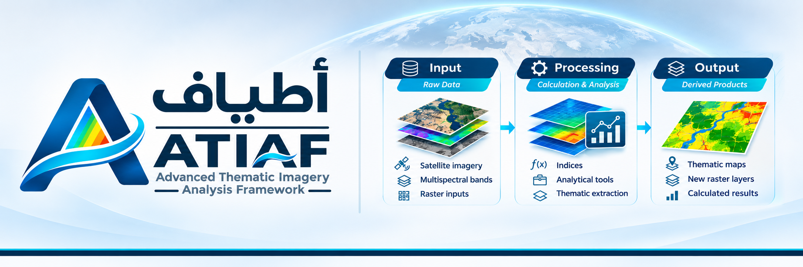

<p align="center"></p>
<p align="center"></p>

# ATIAF

[](LICENSE)
[](CHANGELOG.md)
[](https://github.com/ahmadibrahim4geo/ATIAF/actions/workflows/structure-check.yml)

**Advanced Thematic Imagery Analysis Framework** · MIT · Local satellite imagery analysis.

[العربية](README.ar.md) · [Documentation portal](documentation/index.html) · [Quick start](documentation/en/QUICK_START.md) · [Evidence](Reports/INDEX.md)

One engine, **`atiaf_core` with I**, serves separate native ArcGIS Pro and QGIS adapters. Computation uses your locally downloaded/unpacked images, without provider login, API keys or automatic imagery downloads.

**1.0.4.dev0 is a development recovery build.** Earlier v1.0.0 stable-readiness claims are superseded by [report 0015](Reports/0015_recovery_audit.md). Synthetic tests, native host execution, real satellite products and clean installation are separate evidence levels. See [current state](PROJECT_STATE.md).

## At a glance

| Platform | Entry point | Scope |
|---|---|---|
| ArcGIS Pro | Native English/Arabic Python toolboxes | Requires your separately installed, licensed Pro environment |
| QGIS | Installable Processing provider ZIP | Uses your independently installed QGIS and its scientific dependencies |
| Shared Python core | `atiaf_core/` | One source for discovery, science gates, processing and provenance |
| Documentation | [Offline Index](index.html) · [English](documentation/en/QUICK_START.md) · [العربية](documentation/ar/QUICK_START.md) | Bilingual use guides, formulas, output interpretation and evidence |

**Local by design:** choose a sensor/product, supply imagery or explicit manual bands, select calculations, optionally mosaic/clip, choose a native projected metre CRS, then save. Work/Results accumulate without replacing earlier products. Optional map loading happens sequentially.

## First run

1. Keep the repository together. In Pro open [ATIAF.pyt](ArcGIS%20Pro%20Tools/ATIAF.pyt) for English or [ATIAF_AR.pyt](ArcGIS%20Pro%20Tools/ATIAF_AR.pyt) for Arabic. [Installation](documentation/en/INSTALLATION.md).
2. For QGIS build with `python tools/build_qgis_plugin.py`, install `QGIS Tools/Distribution/ATIAF-QGIS-1.0.4.dev0.zip` using the native plugin manager, enable ATIAF and reopen old dialogs. Source stays under QGIS Tools/atiaf; the ZIP bundles core and bilingual HTML help. Tool language follows QGIS.
3. Follow **sensor/product → input → QA → optional mosaic → explicit calculations → optional polygon AOI → native projected metre CRS → optional map loading → output folder LAST**. No calculations are selected by default.
4. For NDVI select Landsat C2 L2 SR with red, NIR and QA assets. Check NDVI, leave mosaic off and AOI empty, reuse a suitable known source CRS, and inspect the raster plus `Results/Reports/index.html`.

### Obtain the QGIS package

After a successful [Headless package verification workflow](https://github.com/ahmadibrahim4geo/ATIAF/actions/workflows/structure-check.yml), download the **ATIAF-QGIS-development** artifact and extract its outer Actions archive to find the installable plugin ZIP. GitHub requires sign-in to download workflow artifacts. These are development builds, not stable releases.

To build locally from the repository root:

```bash
git clone https://github.com/ahmadibrahim4geo/ATIAF.git
cd ATIAF
python tools/build_qgis_plugin.py
```

The builder preserves existing packages. Use `--output` with a new filename for another build. Install the resulting ZIP in QGIS → Plugins → Manage and Install Plugins → Install from ZIP. Keep Pro/QGIS Python stacks separate; see [installation requirements](documentation/en/INSTALLATION.md).

## Seven independent tools

| Tool | Choices | Highlights & Recent Enhancements |
|---|---|---|
| Spectral Indices | 30 individual optical methods including NDVI, SAVI, EVI, MNDWI, NDMI, NDBI, NBR, and 6 new ENVI 6.3 indices (`MTVI2`, `MCARI2`, `NDRE2`, `CIGREEN`, `CIREDEDGE`, `NDSI_SALINITY`) | Calibrated reflectance and QA; negative optical reflectance clamped to prevent zero division over dark water |
| Surface Temperature | Simplified single-click LST in Celsius or Kelvin with automatic background intermediate NDVI calculation | Defaulted RTE and Planck parameters; intermediate NDVI automatically saved to `Results/Vegetation/NDVI/` |
| Thermal & Urban | UTFVI/classification, hotspots, or both | Official LST; urban heat island diagnostics |
| Environmental & Drought | TM/ETM+ broadband albedo, vegetation drought proxies | Multi-generation Landsat calibration |
| Geological & Mineral | 10 mineral alteration ratios and indices including Ferric Iron, Clay Alteration, and 4 ENVI alteration indices (`FEAI`, `FEI`, `FESI`, `LATI`) | High-sensitivity hydrothermal alteration and rock discrimination |
| Temporal & Change | Multi-epoch NDVI, NBR or LST difference | Ordered date differencing (T2 - T1) with matching sensor and level |
| [Geological Color Composites](documentation/en/GEOLOGICAL_COLOR_COMPOSITES.md) | Direct RGB (`7-5-3`, `7-6-2`, `3-2-1`) and Ratio RGB (`CRC1`, `CRC2`) presets | Dual outputs: high-precision Float32 Analytical GeoTIFF and 8-bit 2% stretched Display GeoTIFF |

### Intelligent QA Mask Engine & White Holes Elimination
ATIAF now features an intelligent, multi-mode quality assessment mask engine (`Cloud_Only_Arid`, `Full_Strict`, `Water_Protected`, `None`):
- **`Cloud_Only_Arid` (Default):** Specifically engineered for arid, rocky, and desert geomorphology (Middle East, North Africa, and global drylands). It strictly masks opaque clouds (bit 3) and snow (bit 5) while bypassing CFMask false-positive cirrus (bit 2) and terrain shadow (bit 4) flags. This **completely eliminates "missing cells / white holes"** over bright desert mountains (23,676 rock pixels recovered in empirical testing) and deep river channels.
- **`Full_Strict`:** Preserves strict masking for high-latitude oceanic imagery.
- **`Water_Protected`:** Shields water bodies from encroachment by dilation or shadow buffers.

### Multi-Generation Satellite Support
- Full automated support for **Landsat 9 & 8 Collection 2 Level-2** surface reflectance and surface temperature.
- Full compatibility with **legacy Landsat 4/5/7/8 Level-1 (Pre-Collection and Collection 1)** scenes via calibrated TOA reflectance (`allow_toa=True`) and thermal radiance extraction.
- **Sentinel-2 L2A & L1C** and **ASTER** physical band discovery.

## Output Structure & File Guide

Outputs are organized cleanly without UUID clutter:
- **`[StudyArea_]Method_Date.tif`:** Analytical Float32 GeoTIFF containing true physical values (reflectance, temperature in Celsius, mineral ratios) for scientific analysis and modeling.
- **`[StudyArea_]Method_Date_DISPLAY.tif`:** 3-band Byte RGB GeoTIFF with natural 2% contrast stretch for instant map visualization.
- **`[StudyArea_]Method_Date.preview.png / .html`:** Standalone graphics and interactive Leaflet map for offline browser viewing.
- **`report.ar.html` & `report.en.html`:** Complete bilingual run reports documenting formulas, sensor metadata, calibration parameters, and statistics.
- **`Processing_Manifest.json` & `Quality_Assessment.csv`:** Full machine-readable lineage, valid pixel counts, and cloud/clear metrics.

## Validation and Evidence

- **192 automated unit tests passing (100%)** in 8.3 seconds.
- **Real dual-scene validation:** Empirically verified on modern Landsat 9 C2 L2 (`LC09_L2SP_174043_...`) and legacy Landsat 8 L1T (`LC81760392014234LGN00`), proving zero NaN corruption and 99.88% reduction in missing pixels in rocky terrain.
- See detailed evidence in [Report 0032](Reports/0032_advanced_envi_indices_and_qa_mask_engine.md) and [Report 0031](Reports/0031_comprehensive_usability_geological_and_envi_integration.md).

## Development

In a separate compatible developer environment:

```bash
python -m pip install .
python tools/build_documentation.py
python tools/validate_package.py
python -m unittest discover tests
```

Native GIS tests run separately in their vendor runtimes. Never install arbitrary binary packages into Pro/QGIS to make a headless check pass. See [contributing](.github/CONTRIBUTING.md), [security/private data](.github/SECURITY.md) and [citation metadata](CITATION.cff). Cite each scientific method's original research alongside this software.

## Repository guide

| Folder | Purpose |
|---|---|
| `atiaf_core/` | Sole shared processing engine; no second implementation with Y |
| `ArcGIS Pro Tools/`, `QGIS Tools/` | Separate thin host adapters |
| `documentation/` | EN/AR help, offline HTML portal, assets; specifications/decisions/roadmaps in `project/` |
| `scientific_library/` | Scientific candidates, sensors and provenance; separate from runnable support |
| `tools/` | Developer maintenance, validation, environment checks and packaging; not GIS analysis tools |
| `tests/` | Synthetic regressions and native host checks |
| `Development_Plans/`, `Reports/` | Numbered plans and immutable evidence |

All tools append to shared `Work/` and `Results/`, preserve earlier products, and use a scene-named folder under a custom destination. Mosaic requires compatible same-day scenes. [Output details](documentation/en/TOOL_UI_AND_WORKSPACE.md).

Original code is MIT. Supplied logo/banner are used at the owner's request; the banner illustrates a workflow and is not runtime evidence. No bulk Index DataBase or external formula catalog is redistributed. [Licenses](development_resources/THIRD_PARTY_LICENSE_POLICY.md) · [Sources](development_resources/SOURCES.md) · [Agent contract](AGENTS.md).


Legacy imagery/output audit1.0.4.dev0: shared metadata/QA/calibration, diagnostic NDVI_TOA, readable outputs and independent unchanged-CRC1 evidence. See [audit delivery0029](Reports/0029_legacy_imagery_audit_fixes_and_validation.md); current sensor support is limited by its explicit real/fixture matrix. Supplied plans move into numbered plan folders, with pristine references only in Source_Archive.
